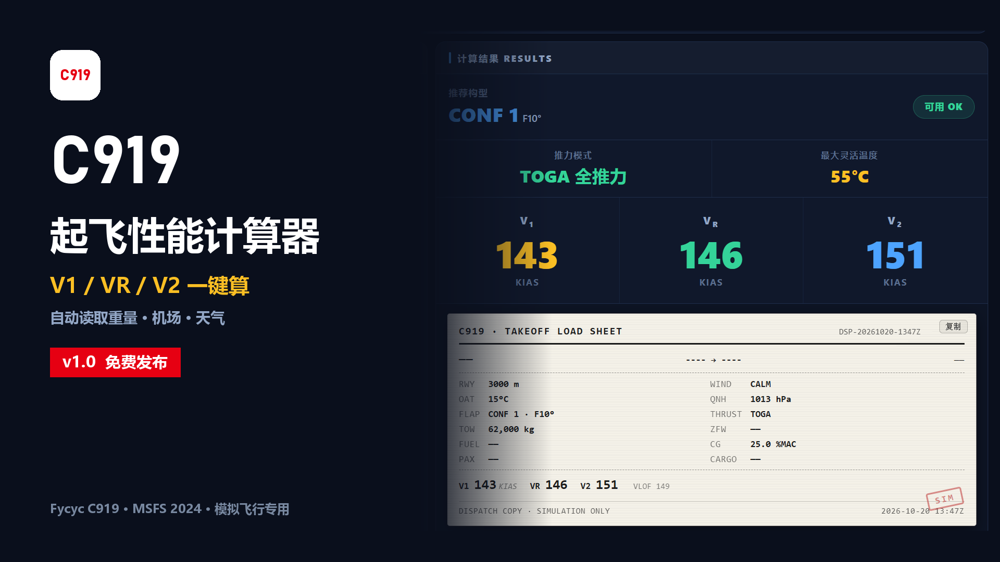

# C919 起飞性能计算器 / C919 Takeoff Performance Calculator

为微软模拟飞行 2024 中的 **Fycyc C919** 打造的起飞性能与配载工具。读取机模数据，一键算出 V1 / VR / V2，并生成跑道剖面和配载舱单。

> ⚠️ 仅供模拟飞行娱乐与技术学习使用，计算结果为近似值，**不可用于真实飞行**。



## 功能

- **一键同步**：通过 SimConnect 读取起飞全重、重心、QNH、机场标高、外界温度、风向风速
- **SimBrief 导入**：自动填入航班号、起降机场、机号、旅客数、货重、ZFW、燃油
- **V 速度计算**：V1 / VR / V2 / VLOF / Vs / VMCA / VMCG，附 CONF 1/2/3 对比表与推荐构型
- **减推力**：TOGA / FLEX，自动计算最大灵活温度
- **跑道剖面图**：滑跑、抬轮、离地、35 ft 点与中断起飞距离，按比例绘制
- **配载舱单**：跑道、风、温度、重量、重心、V 速度一页汇总，可一键复制为纯文本
- **起飞配平（BETA）**：按重心与襟翼给出 UP/DN 配平值，绿区 -2.5 ~ +2.5，含标尺
- **检查更新**：启动时查询 GitHub Releases，正式版更新强制提示、测试版更新可选
- **昼夜主题**：深色 / 米黄色日间模式，窗口顶栏同步配色，选择会记住

## 环境要求

- Windows 10 / 11（64 位）
- 微软模拟飞行 2024
- Fycyc C919 机模（自动读取数据时需要；不装机模也可手动输入使用）
- 免安装 .NET 运行库，单文件绿色版

## 下载

正式版发布包通过以下渠道提供（仓库只放源码，不放 159 MB 的可执行文件）：

- Bilibili：<https://space.bilibili.com/1203628872>
- Flightsim.to：*（条目审核通过后补充）*

**本软件完全免费**，作者未授权任何个人或平台销售、代售或捆绑收费。付费获得均为第三方行为。

## 使用

1. 解压后保持目录结构（`C919起飞性能计算器.exe` 与 `www\` 同级）
2. 运行 exe；若出现 SmartScreen 提示，选择「更多信息 → 仍要运行」（程序未做数字签名）
3. 在模拟器中载入 C919，点软件里的「同步」，或手动填写参数后点「计算」
4. 按结果手动在 CDU 输入 V1 / VR / V2，并按推荐构型设置襟翼

> 本工具**不修改、不注入**任何机模文件，只通过 SimConnect 读取数据。

## 构建

需要 .NET 8 SDK：

```powershell
dotnet publish C919Bridge.csproj -c Release -r win-x64 --self-contained true `
  -p:PublishSingleFile=true -p:IncludeNativeLibrariesForSelfExtract=true -o publish
```

产物为单文件 `C919Bridge.exe`，配合 `publish\www\` 目录运行；发布时把 exe 重命名为 `C919起飞性能计算器.exe`。

版本号需要同时更新两处：`C919Bridge.csproj` 的 `<Version>`/`<FileVersion>`，以及 `www/index.html` 里的 `APP_VERSION`。

## 计算模型与参考

- 适航依据：CCAR-25-R4 / FAR-25 §25.107（起飞速度）、§25.121（单发失效爬升）、EASA CS-25
- 大气模型：ICAO Doc 7488 标准大气
- 方法学：Raymer《Aircraft Design》、Anderson《Aircraft Performance and Design》、Roskam《Airplane Design》
- 机型与发动机数据：中国商飞 C919 与 CFM LEAP-1C 公开资料
- 相关公开文献：
  - 张陈力子, 田永亮, 张帅. 机场条件对民机起飞性能影响规律初探[J]. 民用飞机设计与研究, 2018(1).
  - 徐长群, 陶超. 大型客机积水跑道起降附加阻力评估[J]. 民用飞机设计与研究, 2018(1).
  - 蒋苗, 吴洋. CJ818高原起降单发失效爬升梯度分析[J]. 民用飞机设计与研究, 2009(S1).

## 版本

当前为 1.1.2 BETA（测试版）：新增起飞配平与检查更新，其余计算逻辑与 1.0.0 一致。

## 已知限制

- 目前只校验跑道长度约束，**未实现第二段爬升梯度校验**（OEI 3.3% / 双发 2.4%）
- 最大升力系数按重量反算，非真实气动标定值
- FMS 数据需手动输入，程序不提供自动写入

## 致谢

- 机模作者 Fycyc（本工具与机模作者无隶属关系）
- 数据接口 CsSimConnect

## 许可

源代码以 MIT 许可发布，见 [LICENSE](LICENSE)。机模、商标及相关素材版权归各自权利人所有。

---

## English

A takeoff performance and loadsheet tool for the **Fycyc C919** in Microsoft Flight Simulator 2024. It reads weight, CG, airport and weather data via SimConnect, computes V1/VR/V2 in one click, and draws a runway profile plus a dispatch-style loadsheet.

**For flight simulation only — not for real-world use.**

Features: one-click sync, SimBrief import, V1/VR/V2/VLOF/Vs/VMCA/VMCG with CONF 1/2/3 comparison, TOGA/FLEX with flex temperature, runway profile, copyable loadsheet, day/night themes.

Requirements: Windows 10/11, MSFS 2024, Fycyc C919 (for automatic data; manual input works standalone).

The calculator does not modify or inject anything into the aircraft. V-speeds are entered into the CDU manually.

Source is MIT licensed. Trademarks and aircraft assets belong to their respective owners.
